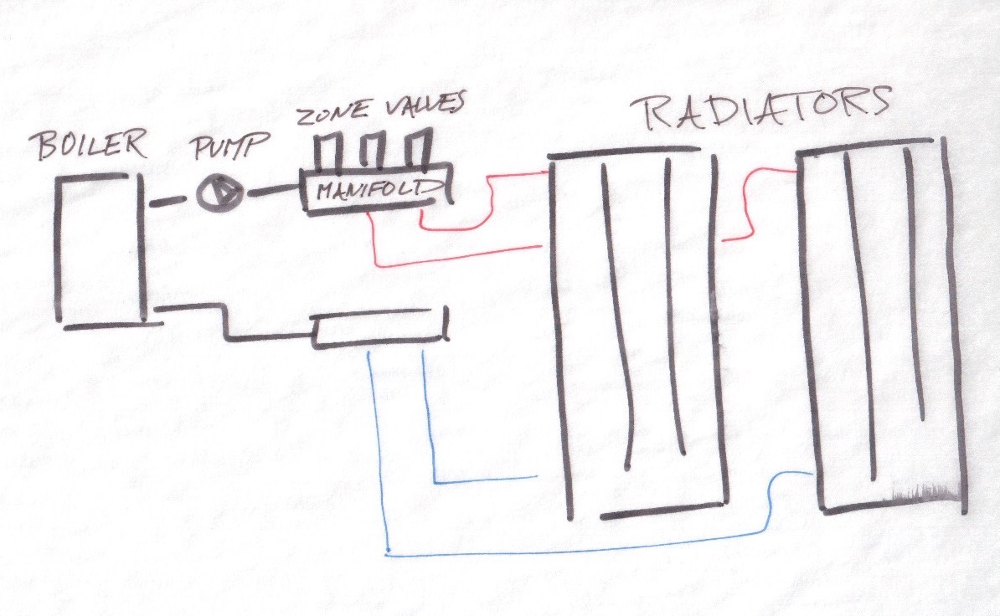
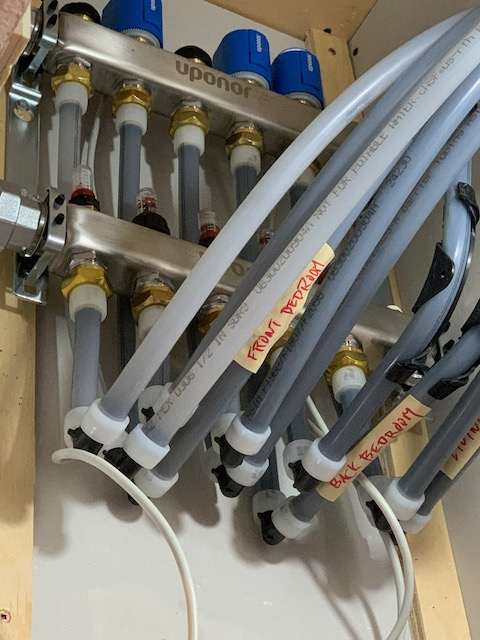
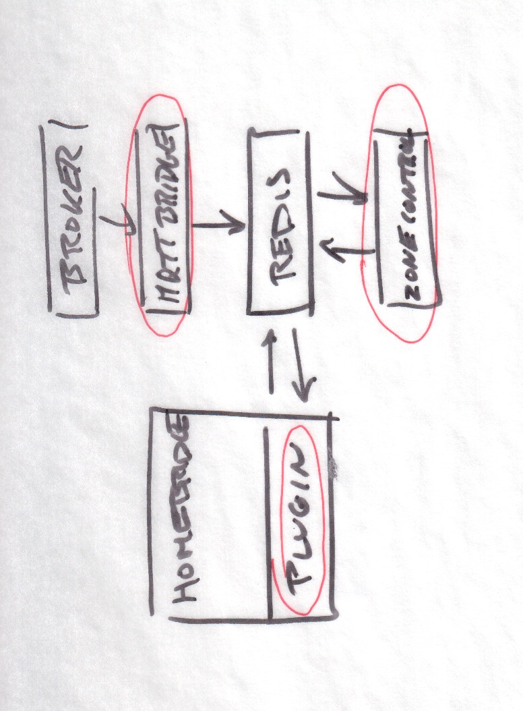

The philosophy guiding this project and its documentation is straightforward: get it working then make improvements as needed. Perfection is the enemy of progress.

# Plumbing

Overall the heating system is quite simple. A boiler is connected via a manifold with zone valves to a series of radiators. When a zone calls for heat, first the zone valve opens, and when that is complete, the boiler and pump are then turned on.


Manifold with zone valves


# Electronics
A beaglebone SBC running debian hosts all the software pieces as well as interfacing via GPIO to a relay board. The relays control the zone valves as well as the boiler


Beaglebone and relay board

# Software
This project contains the logic for zone and boiler control. Sensor data is sent to an MQTT broker (mosquitto in this case). A simple bridge written in python publishes these values to redis. The homebridge plugin reads and writes respective values to redis. This project reads those values and toggles the physical gpios.
The bits circled in red are the ones I've written. The UI is implemented as a [Homebridge plugin](https://github.com/GJMontreal/heating) 




## Two heating systems
Every zone belongs to one of two systems. The `system` field in the config says which.

- **Hydronic** is the boiler, the pump and the zone valves, driven from the BeagleBone's GPIO. Each valve has an end switch that closes when the valve is open. The boiler thread turns the boiler on when any end switch is closed. This is the only system with feedback, because the end switch confirms the valve moved.
- **Electric** is the Stairwell radiator behind a Zigbee relay, driven over MQTT. It has no end switch and no state feedback. The zone sends a power value and never learns whether the relay switched. An electric zone never calls the boiler, and the config refuses an `end_switch` on it.

## How a zone works
Each zone has a temperature sensor, a setpoint and one or more outputs. One thread per zone does the work.

1. A PID loop compares the current temperature to the setpoint and produces a control value between 0 and 1.
2. The zone turns that value into a duty cycle over a ten minute window. A control value of 0.3 opens the valve for three minutes of each ten. It publishes the result as the zone's `heating_cooling_state`.
3. The zone then calls each of its outputs with that state. An output is a local GPIO pin or an MQTT relay. MQTT messages go out on a separate thread, so a slow broker never delays the zone.
4. For hydronic zones, the boiler thread reads the end switch on each zone valve. It turns the boiler and pump on when any valve is open.

A boost flag in redis forces a zone open regardless of the PID output. Gpio outputs can be configured active low per zone.

If a reading stops changing for two hours, the zone calls for no heat until a new one arrives. A tick that fails, because redis is down for example, is retried. After three failures in a row the zone switches its outputs off.

## Redis keys
Every zone is identified by a sensor path such as `/home/sensors/kitchen`.

| Key | Written by | Value |
| --- | --- | --- |
| `<sensor_path>/current_temperature` | MQTT bridge | JSON with `value` and `time` |
| `<sensor_path>/target_temperature` | Homebridge | JSON with `value` |
| `<sensor_path>/target_heatingcooling_state` | Homebridge | 0 off, 1 heat. Anything else counts as off |
| `<sensor_path>/control_value` | zone | 0 to 1 |
| `<sensor_path>/boost` | Homebridge | JSON boolean |
| `<sensor_path>/heating_cooling_state` | zone | 0 or 1 |

Each service also publishes its decisions as JSON with a `time` field. `<mode>` is `active` for the running service and `shadow` for the shadow service.

| Key | Written by | Value |
| --- | --- | --- |
| `heating/<mode>/zones/<zone name>` | zone | `system`, `control_value`, `state` (0, 1 or null before the zone has a target state) and `time` |
| `heating/<mode>/hydronic/boiler` | boiler thread | `call` (0 or 1) and `time`. The shadow service derives the call from its zones' decisions, because it reads no pin |
| `heating/<mode>/heartbeat` | boiler thread | `time`, once per poll |

## Configuration
Zones, the boiler output and the redis and MQTT endpoints are described in JSON. `config/system_config.json` is the default config file. A zone is one sensor, one PID and one kind of output: local GPIO pins or an MQTT relay. Each zone names its `system`, `hydronic` or `electric`. A gpio output on a hydronic zone may name an `end_switch` pin, and the boiler follows all of them. The config needs at least one hydronic zone with an `end_switch`. A zone can also set `control_interval` (the duty window in minutes) and `pid` gains. The program refuses to start on a config it cannot use, and says why.

## Status
The `more_better_modular` branch is the development branch. It replaced the original scripts with the `boiler_relay` package. `deploy.sh`, `deploy/switch.sh` and the systemd units have been written for it and have not been run against the device.

## Running
```
python3 -m venv .venv && . .venv/bin/activate
pip install -r requirements.txt
python -m boiler_relay
```
A local redis is required. `boiler_relay/gpio.py` uses `Adafruit_BBIO` when it is installed. Without it, a stub switches nothing and a warning is logged at startup.

## Deploying
`./deploy.sh <user> <host>` fills in the unit and setup templates from `deploy/`, syncs the package and config with `rsync --delete` and builds a virtualenv on the device. The service is `boiler_relay_v2`. It installs to `/var/lib/boiler_relay_v2` and runs as `SERVICE_USER` (default `heating`, created by the caller and a member of `gpio`). `.venv` survives the sync. The script refuses `/var/lib/boiler_relay` and `/home/debian/boiler-relay`, which belong to the legacy service.

The script prints the command that copies the units to `/etc/systemd/system` and installs the legacy drop-in. The drop-in, `deploy/boiler_relay.service.d/conflicts.conf`, makes `boiler_relay.service` conflict with v2.

`deploy/switch.sh <user> <host> legacy|v2|shadow` runs over `ssh -t` with sudo. It stops the old services, waits until they are inactive, starts the new ones and moves the boot-time enable. It changes nothing if the target unit is missing or does not stay up.

- `legacy` runs `boiler_relay` and enables it at boot.
- `v2` runs `boiler_relay_v2` and enables it at boot.
- `shadow` keeps `boiler_relay` in control and adds `boiler_relay_v2_shadow`. The shadow unit has no `[Install]` section, so it never starts at boot.

`boiler_relay_v2_shadow.service` runs `python -m boiler_relay --shadow`. Shadow mode reads the same sensor keys and makes the same decisions, but it drives no GPIO, sends no MQTT and writes only under `heating/shadow/`. The active service publishes the same keys under `heating/active/`.

The scripts never touch `mqtt_bridge.service`. The bridge lives in `GJMontreal/mqtt-bridge`, and the legacy, v2 and shadow services and Homebridge all read what it writes.
