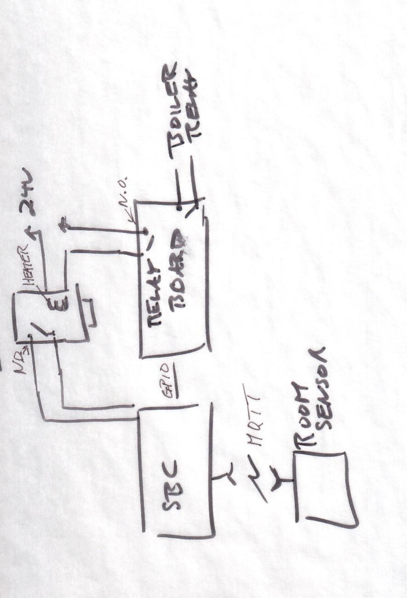
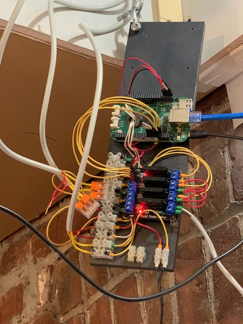
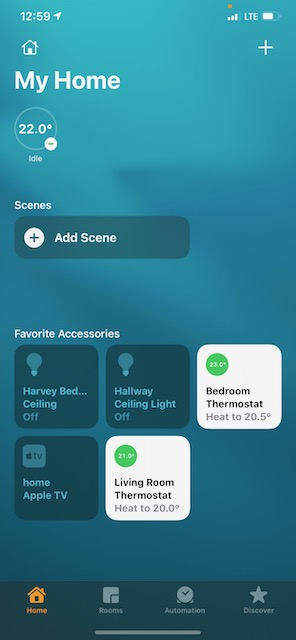

The philosophy guiding this project and its documentation is straightforward: get it working then make improvements as needed. Perfection is the enemy of progress.

# Plumbing

Overall the heating system is quite simple. A boiler is connected via a manifold with zone valves to a series of radiators. When a zone calls for heat, first the zone valve opens, and when that is complete, the boiler and pump are then turned on.


Manifold with zone valves


# Electronics
A beaglebone SBC running debian hosts all the software pieces as well as interfacing via GPIO to a relay board. The relays control the zone valves as well as the boiler


Beaglebone and relay board

# Software
This project contains the logic for zone and boiler control. Sensor data is sent to an MQTT broker (mosquitto in this case). A simple bridge written in python publishes these values to redis. The homebridge plugin reads and writes respective values to redis. This project reads those values and toggles the physical gpios.
The bits circled in red are the ones I've written. The UI is implemented as a [Homebridge plugin](https://github.com/GJMontreal/heating) 




## How a zone works
Each zone has a temperature sensor, a setpoint and one or more zone valve outputs.

1. A PID loop compares the current temperature to the setpoint and produces a control value between 0 and 1.
2. The zone valve thread turns that value into a duty cycle over a ten minute window. A control value of 0.3 opens the valve for three minutes of each ten.
3. The boiler thread reads one call-for-heat input per zone. It turns the boiler and pump on when any zone is calling.

A boost flag in redis forces a zone open regardless of the PID output. Outputs can be configured active low per zone.

## Redis keys
Every zone is identified by a sensor path such as `/home/sensors/0xFD69`.

| Key | Written by | Value |
| --- | --- | --- |
| `<sensor_path>/current_temperature` | MQTT bridge | JSON with `value` and `time` |
| `<sensor_path>/target_temperature` | Homebridge | JSON with `value` |
| `<sensor_path>/target_heatingcooling_state` | Homebridge | 0 off, 1 heat, 2 cool |
| `<sensor_path>/control_value` | PID thread | 0 to 1 |
| `<sensor_path>/boost` | Homebridge | JSON boolean |
| `<sensor_path>/heating_cooling_state` | zone valve thread | 0 or 1 |

## Configuration
Zones, the boiler output and the redis and MQTT endpoints are described in JSON. `system_config.json` is the format the modular version reads: each zone lists a set of typed outputs, which can be a local GPIO or an MQTT relay.

## Status
The `more_better_modular` branch is the development branch. It replaced the original scripts with the `src` package behind a new `main.py`. The systemd unit and `deploy.sh` still point at the old `boiler_relay.py` and need updating.

## Running
```
python3 -m venv .venv && . .venv/bin/activate
pip install -r requirements.txt
python main.py --config system_config.json
```
A local redis is required. Off the BeagleBone, `src/gpio.py` stands in for the real GPIO library and prints instead of switching pins.

## Deploying
`./deploy.sh <user> <host>` fills in the unit and setup templates, copies the files over ssh and builds a virtualenv on the device. It deletes the existing install directory first.

